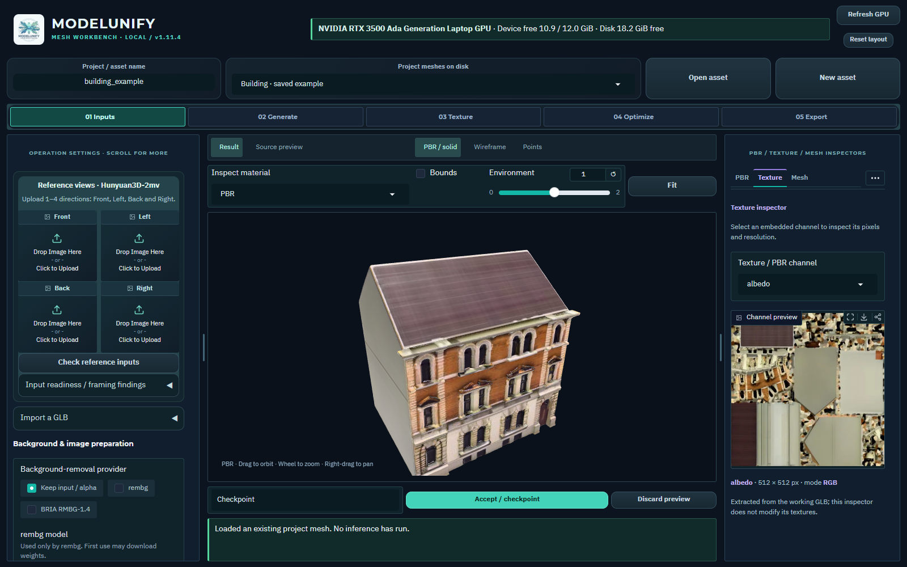
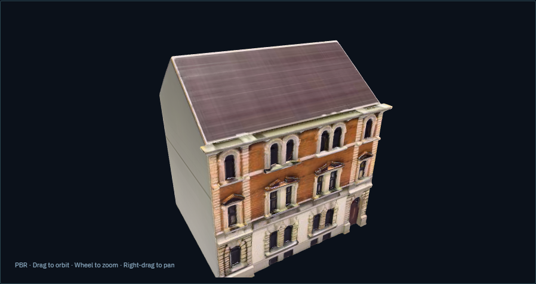
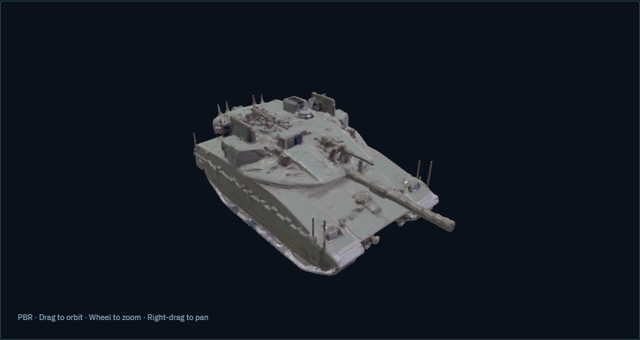
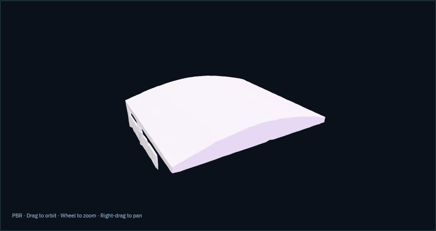
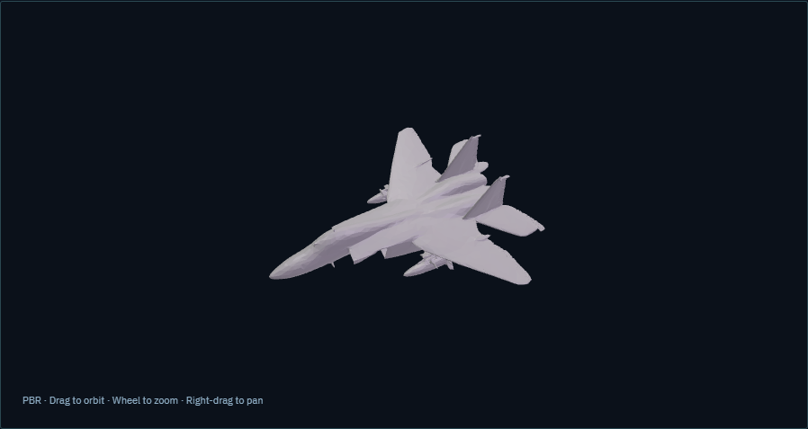

# ModelUnify

ModelUnify combines image-to-3D generation, PBR texturing, mesh inspection,
optimization and export in one local Mesh Workbench. Falcon BMS is the primary
workflow; the tools also support presentation, printing and game prototyping.

**Version 1.12.1** · [Change history](CHANGELOG.md) · [GitHub downloads](https://github.com/AsafBSh/ModelUnity/releases)

The actual Mesh Workbench: operation settings on the left, one 3D viewport in
the center and inspectors on the right. Resize the side panels and scroll inside
them for advanced controls. This overview was captured in v1.11.4;
[explore the illustrated guide](docs/OPERATING_GUIDE.md#screen-tour).

## Install and launch

The release **source ZIP** includes code, guides and screenshots. Extract it to a
new folder and follow setup below. It contains no Python runtime, AI weights or
installer; the ZIP's SHA-256 companion verifies the download.

Follow [Windows installation](docs/INSTALLATION.md), then double-click
`run_modelunify.bat`. Open **Models** to install only the
[models you need](docs/MODEL_WEIGHTS.md) from the GUI.
Edge or Chrome opens a dedicated application window. `--browser` uses a browser
tab and `--server` runs a foreground server that you can stop with Ctrl+C.
Closing only the application window leaves its server and jobs running.

The repository contains application source and patched upstream source/licenses.
Weights, environments, private references and generated assets are downloaded or
created locally. Existing-mesh inspection, CPU optimization, UV rebaking and
export work without AI checkpoints once the main environment is installed.

## Use the workbench

1. **Inputs** — upload references or import a mesh; inspect and correct masks.
2. **Generate** — choose a backend, its input mode and model-specific settings.
3. **Texture** — paint PBR maps and inspect actual channels and coverage.
4. **Optimize** — reduce geometry, protect important parts and review the result.
5. **Export** — apply measured scale, configure LODs and download a complete package.

Use one persistent 3D viewport, resizable side panels and the PBR, Texture, Mesh,
UV, Project, Reference and Jobs inspectors. Save projects and accept named
checkpoints after reviewing each operation. Preserve the original and raw master.

Read the [practical operating guide](docs/OPERATING_GUIDE.md) or its
[illustrated Word guide](docs/ModelUnify_Operating_Guide.docx) for detailed controls,
model selection, accuracy checks and troubleshooting.
Both guides cover the Models manager. Older workflow screenshots retain their original version labels.

## Install and manage AI models

Choose **Models** in the asset toolbar or **Manage required models** beside the
current operation. Install, verify, repair and update checkpoints, follow live
transfer progress, cancel and resume downloads, and review exact owned files
before removal. Shared checkpoints are reused. Choose a model drive, register
existing files read-only, and manage the separate ComfyUI runtime in the same window.

**Downloaded** and **ready to run** are separate states: verify runtimes and resolve
missing prerequisites before inference. Generation never starts hidden downloads.
See the [model manager guide](docs/MODEL_WEIGHTS.md#use-the-models-workspace).

## Available models

- **TripoSG 1.5B** — one image to mesh.
- **Hunyuan3D-2mv** — 1 to 4 directional images to mesh.
- **Hunyuan3D-2.1 Paint** — mesh and reference image to PBR textures.
- **TRELLIS.2 via ComfyUI** — one image to shape and optional PBR.
- **Pixal3D via ComfyUI** — one image, or a separate multiview model for matched
  fixed-orbit directions sharing framing and FOV.

Optional preparation includes RMBG/rembg; normal-map options include geometry,
StableNormal and Marigold. Learned tools need their own weights. Model choices
and parameters appear in the relevant stage; selecting a model does not install it.

Windows/NVIDIA CUDA is the validated AI target. CPU diffusion fallback is slow;
AMD ROCm and Intel XPU inference are not integrated. Original TRELLIS/Pixal
research stacks are Linux-first; this integration uses Windows-capable native
ComfyUI nodes in a separate environment. The main and Comfy environments use
different Torch/CUDA versions and must remain separate.

## Guides

- [Installation and prerequisites](docs/INSTALLATION.md)
- [GUI and model operation](docs/OPERATING_GUIDE.md)
- [Optional model downloads](docs/MODEL_WEIGHTS.md)
- [ComfyUI setup and controls](docs/COMFYUI.md)
- [BMS export and external finishing](docs/BMS_WORKFLOW.md)
- [Build a portable Windows bundle](docs/BUILD_PORTABLE.md)
- [Contribute through pull requests](docs/CONTRIBUTING.md)

## Example assets

These screenshots show existing saved assets displayed in ModelUnify.
No new inference was run for the screenshots; generated meshes and original
references are not bundled with the repository. They illustrate inspection,
not guaranteed geometric accuracy or BMS readiness.

### Textured building

40,000 triangles with UVs and embedded albedo, metallic/roughness and normal maps.
Check openings, dimensions and the less-visible sides before export.

### Textured tank

40,000 triangles with embedded PBR maps. Inspect tracks, barrel and silhouette;
this static mesh does not provide an articulated turret or other animation.

### Hangar and jet geometry

Earlier Hunyuan3D-2mv hangar output, approximately 20,000 triangles. This saved
shape has no UVs or texture maps. Review closed openings, disconnected parts and
inconsistent winding before using it.

Earlier TRELLIS.2 jet output, approximately 20,000 triangles. This is a static
shape without UVs or embedded textures; inspect wings and thin parts carefully.

## Outputs and limitations

Working assets use GLB. Export can include OBJ/MTL, PBR companions, 1 to 7 LODs,
reports and optional static BMS sidecars. BML/DDS conversion, actual MTI slot
reconciliation, object registration and in-game validation remain external.
AI meshes require reference and dimension checks, especially for thin parts,
openings, tanks, aircraft and buildings. Atlas size and triangle count do not
establish geometric accuracy.

## Credits and licenses

TripoSG is by Tripo AI/VAST-AI Research; Hunyuan3D is by Tencent. ComfyUI hosts
the integrated TRELLIS.2/Pixal3D implementations. RMBG, rembg, RealESRGAN and the
normal estimators retain their upstream terms. See [vendor provenance](vendor/README.md)
and the actual upstream license/notice files before redistributing code, weights
or generated assets. InstaLOD integration stages files for Studio; it does not
include a licensed Pipeline engine.
