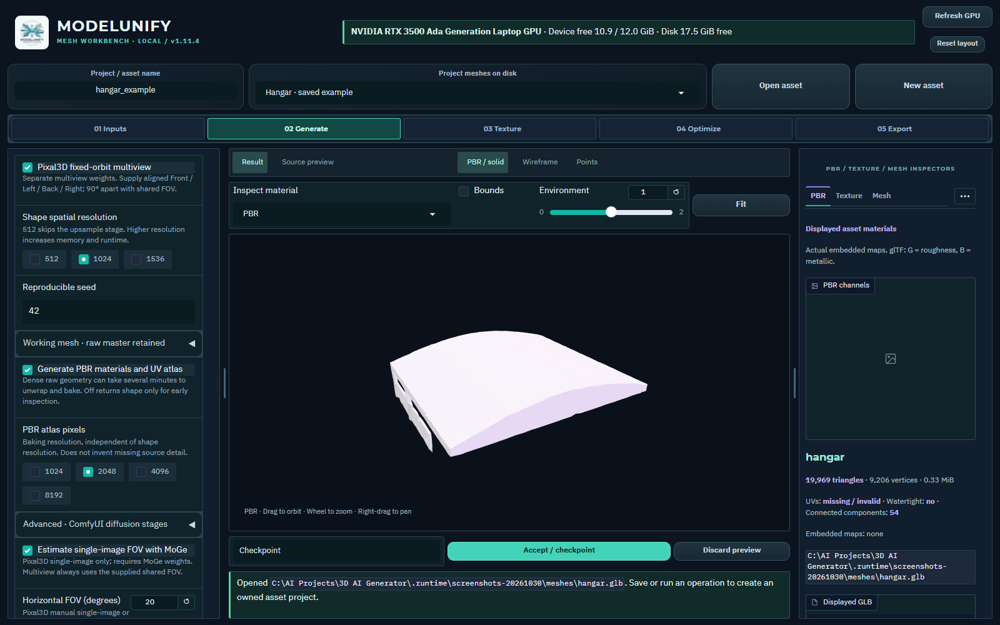

# TRELLIS.2 and Pixal3D hosting

ModelUnify can submit image-to-3D jobs to a local ComfyUI server using its native
core 3D nodes. Mesh Workbench remains the interface: Inputs → Generate → PBR
inspection → Optimize → Export. No custom-node pack is required.

The integration targets **Windows / NVIDIA CUDA**. Original upstream research
stacks are Linux-first; this adapter instead uses the Windows-capable ComfyUI
implementation. AMD / Intel GPU inference is not validated. Results are generated
assets, not dimensionally exact reconstructions; measure tanks, aircraft and
buildings against reference dimensions before BMS export.

## Workbench controls

In v1.12.0, open **Models** to install TRELLIS/Pixal checkpoints and their shared
components, track downloads, and cancel/resume or repair them. Expand **ComfyUI
runtime and paint extensions** to install/repair the isolated runtime and verify
its actual Torch/CUDA stack. Start/stop/check the host from the same panel.
The [Models guide](MODEL_WEIGHTS.md#use-the-models-workspace) is the primary setup
flow; CLI commands below remain an advanced alternative for external caches.
Managed model directories are registered through a separate extra-model-paths
configuration; existing Comfy configuration is preserved. Restart an owned host
after adding a model location. External hosts are not restarted automatically.



In Generate, choose TRELLIS.2 or Pixal3D, then scroll within the left panel.
Pixal3D exposes the separate fixed-orbit multiview option; TRELLIS.2 takes one
image. Shape resolution, optional PBR and working-mesh cleanup have independent
controls. The pictured hangar is a previously saved Hunyuan mesh: changing the
backend configures the next job and leaves the existing preview intact.

This capture shows the menu, not a successful host-readiness check or a new
generation. Install and verify the selected weights/runtime through Models before submitting AI work.

## Install once

From the source project root, in PowerShell:

```powershell
.venv/Scripts/python.exe -m scripts.comfyui_host setup --model all
```

Choose `trellis`, `pixal` or `pixal-mv` instead of `all` to install fewer weights.
`setup --skip-models` installs only the runtime; `download --model pixal` installs
weights later. Setup needs internet access, disk space and an NVIDIA driver
compatible with the selected CUDA wheel. It installs a separate Python environment
and ComfyUI under `.runtime/comfyui/`, preserving ModelUnify's existing torch stack.
The initial ComfyUI source is pinned to commit
`7a28332047b6af638dc6c7f72ef3481a718769fd` (0.42.0); setup never resets an existing
checkout. Native node/checkpoint compatibility is checked before each submission.
Default runtime wheels: torch 2.14.1 / torchvision 0.29.1, CUDA 13.0.

Checkpoint downloads use the official Comfy-Org Hugging Face repositories and
record resolved repository revisions and sizes in `models/modelunify_downloads.json`.
Common vision / VAE weights are shared. Expect roughly 8 GiB of weights for
TRELLIS.2 and roughly 19 GiB for all three variants, plus the runtime. Upstream
model licenses apply separately from ComfyUI's software license; read the relevant
model cards before distributing weights or commercial assets.

## Use the workbench

1. Launch `run_modelunify.bat`, select **Generate**, then choose
   **TRELLIS.2 · ComfyUI** or **Pixal3D · ComfyUI**.
2. Expand **Local ComfyUI host**. **Start host** starts the configured installed
   runtime or attaches to an already running compatible endpoint. **Check model**
   checks the exact selected workflow's nodes and checkpoint filenames.
3. Upload inputs and configure shared background preparation. Existing alpha is
   retained when requested. Prepared images are composited onto black for these
   models; ComfyUI performs no hidden second background removal.
   Use an isolated foreground: for ordinary photographs, explicitly choose
   rembg/RMBG. Keeping a scene background can reconstruct the background itself.
4. Configure shape resolution, seed, structure/shape/upsample/texture steps,
   guidance, working-mesh cleanup, optional PBR generation and atlas size.
   Run **Generate mesh**.
5. Review the result in the existing single viewer and PBR/texture/UV inspectors.
   Accept a checkpoint before subsequent optimization/export if desired.

**TRELLIS.2** accepts one Front image in this adapter. **Pixal3D single-image**
uses one image and either MoGe-estimated or manually supplied horizontal FOV.
**Pixal3D multiview** uses separate checkpoint weights and 1–4 named directions,
90° apart at the same framing/scale, with a shared horizontal FOV. Supply square,
aligned views with the object occupying approximately 1/1.1 of the width. The
first supplied direction becomes the mesh's front if Front is omitted. Arbitrary
satellite/ground photographs with different poses are not calibrated automatically.
Individual crops and mismatched original dimensions are rejected in multiview.

Resolution 512 skips the upsample stage; 1024/1536 execute it. Texture stage controls
apply only when PBR is enabled. Atlas size is a baking size, not input-image detail.
MoGe is used only in automatic single-image Pixal3D mode. Native Hunyuan presets
and chained-paint controls do not affect ComfyUI runs. Default diffusion checkpoints
are Comfy-Org **INT8** repacks, not identical-precision research weights.

## Hosting and configuration

`model.comfyui` in `config.yaml` defines loopback URL, server/Python paths, timeouts,
memory mode (`auto`, `lowvram`, `normalvram`, `highvram`) and whether an installed
host may autostart. Restart ModelUnify after editing it. No resolution reduction
or checkpoint download happens implicitly when generating. For an existing ComfyUI
installation, set its `server_dir` / `python_exe` / `url` and install compatible
native core nodes and weights; `autostart: false` attaches only.

```powershell
.venv/Scripts/python.exe -m scripts.comfyui_host start
.venv/Scripts/python.exe -m scripts.comfyui_host status --model pixal-mv
.venv/Scripts/python.exe -m scripts.comfyui_host stop
```

Status exits 1 when unavailable; it does not download or run inference. Stop only
terminates a verified ModelUnify-owned idle process. External hosts stay running.
Cancellation targets the submitted Comfy prompt; older servers without targeted
cancellation only remove that pending prompt and discard any executing result.
Host logs/state live under `.runtime/comfyui/hosts/`. The advanced Comfy editor is
available separately at the configured localhost endpoint if needed.

`weights` may override keys `trellis`, `pixal`, `pixal_mv`, `shape_vae`, `texture_vae`,
`vision`, `moge` with filenames already installed in the appropriate Comfy models
folder. Setup only downloads official default filenames; custom overrides are
installed manually. Readiness rejects unsupported node schemas or missing weights.

## Outputs and limits

Every job retains prepared images/masks, API workflow, node schemas, prompt ID,
server history, checkpoint names, settings and input/master/workflow hashes.
`master.glb` preserves decoded geometry before optional UV/PBR work. `asset.glb`
contains the reviewed result; optional PBR bakes base colour and metallic/roughness.
Normal/AO baking is not part of this initial Comfy graph. Dense decoded geometry
can take several minutes to UV unwrap and pack, even at 512 shape resolution;
disable PBR for an earlier shape inspection. The visible working-mesh controls
default to solid remeshing at 768 and a 700,000-face midpoint decimation budget,
following the official workflow's cleanup approach. Both can be disabled: turn
remeshing off and set the budget to 0 for a raw result. Remeshing changes topology
and may close openings or merge thin parts; QEF sharp-edge recovery is optional.
No small-component removal, smoothing or input preclustering is enabled in this
adapter. Compare working copies to the raw master before accepting them.
UV unwrapping can split vertices; mesh inspection reports
actual counts, components, UVs, materials, winding and bounds. Originals stay intact.
The final static GLB must pass validation before becoming a workbench preview.
Transfer/validation failures cannot replace an accepted mesh.

CLI example (output directory must be fresh):

```powershell
.venv/Scripts/python.exe -m scripts.generate_3d comfy --model trellis --front inputs/tank.png --output-dir outputs/tank_comfy --resolution 1024
```

Use `--model pixal-mv --front ... --left ... --back ... --right ... --manual-fov
--fov 20` for matched views; `comfy --help` lists advanced stage parameters.
The legacy UI links users to the full workbench controls. Existing generated
portable distributions do not automatically include this new runtime or source.

## Installation planning and live jobs

`python -m scripts.comfyui_host plan --model trellis` is read-only and checks
disk, checkpoint sizes and the NVIDIA driver family. Setup uses pinned source;
existing nonempty/unrecognized destinations are preserved. Runtime installation
and downloads are explicit, while normal Generate never installs packages or models.

`run_comfyui_setup.bat trellis` accepts trellis, pixal, pixal-mv or all. Portable
builds include Setup ComfyUI.bat; the installer can offer model choices. Embedded
Python can bootstrap a private PSF-signed Python without changing PATH. Allow
multi-GB installation working space and check the successful CUDA probe.

Live progress follows the submitted prompt's node/sampler events. Server history
remains the completion authority if events disconnect. Review actual reports,
warnings and geometry against references before accepting a result.
