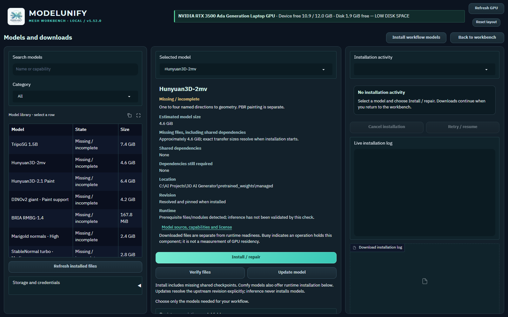

# Optional model weights

AI checkpoints are optional downloads and are excluded from Git. Model
integrations remain part of the application. Keep shared cache locations in mind
when moving or removing weights used by more than one program.

Without weights, launch the GUI and use existing-mesh inspection, manual alpha
correction, CPU optimization, UV rebaking of existing maps, scaling and export.
Generation, painting, learned background removal and AI normals need restoration.
A fresh Git clone additionally needs [INSTALLATION.md](INSTALLATION.md).

## Use the Models workspace

ModelUnify v1.12.0 manages downloads inside the GUI. After installing the main
application environment, no terminal commands are needed for model installation.



1. Open **Models** from the asset toolbar, or **Manage required models** in the
   current workflow stage. Choose a model from the searchable library.
2. Read its capabilities, linked model terms, required components and estimated
   size. In **Storage and credentials**, choose a dedicated model folder with
   enough room for the model, shared dependencies and installation headroom.
3. Choose **Install / repair**, or **Install workflow models** for the current
   stage's selected checkpoints. Shared components are reused. Pixal's MoGe
   dependency is needed only for automatic single-view FOV; the texture VAE is
   required only when Comfy PBR is selected.
4. Follow **Installation activity**: resolving, downloading, verifying and
   installing are distinct stages. Downloads show actual bytes, measured speed
   and an estimated remaining time when available. Runtime installation shows
   its log with indeterminate progress rather than a made-up percentage.
5. Use **Cancel installation** and **Retry / resume** when needed. Jobs survive
   browser reconnects; after a server restart, interrupted jobs wait for Retry.
   Partial bytes and pinned revisions are retained. A server must stay running
   for background work; closing only the dedicated app window leaves it running.
6. Check **Ready** before generation. Files, dependencies and runtime verification
   are separate checks; readiness is not a claim that inference was tested.

**ComfyUI runtime and paint extensions** offers isolated Comfy installation,
runtime verification, host start/stop/check, paint extension builds and paint
runtime verification. These run as tracked jobs. Comfy runtime repair requires
its host to be stopped. Native paint builds require compatible MSVC/CUDA tools
already installed; the app does not silently install system toolchains.

**Verify files** hashes the recorded installation; **Update model** resolves a new
upstream revision explicitly. **Register an existing model folder** checks an
external copy against source hashes and leaves it read-only. Sources without a
published digest must use their curated download instead. Existing default Hub,
TripoSG, rembg and Comfy locations are discovered locally; discovery alone does
not mark files verified. Registration needs source metadata access.

**Remove owned model files** previews recorded managed revisions and their logical
byte sizes before confirmation. Active models and shared components required by
installed models cannot be removed. External/shared caches and unrelated files
stay intact. **Discard retained download files** separately reviews temporary
files and completed files from an unpublished installation. Published models
are preserved; discarded bytes must be downloaded again if that job is retried.

A Hugging Face token, if required by the source, can be entered for the current
server session. It is kept in memory and is not written to projects, jobs, logs
or configuration. Review access terms through the model's source link first.

New installations default to `pretrained_weights/managed/`. Inventory, jobs,
verification records and the saved storage preference live in
`.runtime/model_manager/`. Changing the destination affects new jobs; existing
models and retries retain their recorded locations. File size/integrity checks
and runtime probes never run model inference. Starting the GUI and queuing
generation do not download missing checkpoints.

Windows/NVIDIA CUDA is the AI target. ONNX CPU background removal and existing-mesh
CPU tools remain available on other vendors. AMD ROCm / Intel XPU inference is
not integrated. Comfy uses a separate environment; original research stacks are
Linux-first. Native shape CPU fallback must be explicitly configured.

## Optional manual downloads

The commands below are for advanced setup or restoring an external cache. After
using them, open Models and **Verify files** or register the existing folder.
They require the main venv, network access and disk space. Normal users should
use the tracked GUI flow above.

## TripoSG

About 7.40 GiB logical including its VAE and image encoder:

```powershell
.venv/Scripts/python.exe -c "from huggingface_hub import snapshot_download; snapshot_download('VAST-AI/TripoSG', local_dir='pretrained_weights/TripoSG')"
```

## Hunyuan3D 2mv

The configured wrapper uses FP16 safetensors, about 4.59 GiB. A .ckpt copy is
not needed for this configuration.

```powershell
.venv/Scripts/python.exe -c "from huggingface_hub import snapshot_download; snapshot_download('tencent/Hunyuan3D-2mv', allow_patterns=['hunyuan3d-dit-v2-mv/config.yaml','hunyuan3d-dit-v2-mv/model.fp16.safetensors'])"
```

If config.yaml changes, use its actual model repository/subfolder/variant.

## Hunyuan Paint

The Paint download is approximately 6.41 GiB logical; DINOv2 giant adds 4.23 GiB.
RealESRGAN adds about 64 MiB. NVIDIA CUDA and native paint extensions are separate
requirements. Keep low-VRAM mode on for the 12 GB validation GPU.

```powershell
.venv/Scripts/python.exe -c "from huggingface_hub import snapshot_download; snapshot_download('tencent/Hunyuan3D-2.1', allow_patterns=['hunyuan3d-paintpbr-v2-1/*']); snapshot_download('facebook/dinov2-giant', allow_patterns=['config.json','preprocessor_config.json','model.safetensors'])"
New-Item -ItemType Directory -Force vendor/Hunyuan3D-2.1/hy3dpaint/ckpt
Invoke-WebRequest -Uri 'https://github.com/xinntao/Real-ESRGAN/releases/download/v0.1.0/RealESRGAN_x4plus.pth' -OutFile 'vendor/Hunyuan3D-2.1/hy3dpaint/ckpt/RealESRGAN_x4plus.pth'
```

On a fresh machine build the native extensions with compatible MSVC/CUDA tools;
Git excludes machine-specific binaries. See [INSTALLATION.md](INSTALLATION.md).

## Background removal

Keep alpha and manual correction need no learned remover. Restore BRIA RMBG:

```powershell
.venv/Scripts/python.exe -c "from huggingface_hub import snapshot_download; snapshot_download('briaai/RMBG-1.4', local_dir='pretrained_weights/RMBG-1.4')"
```

Download rembg U2Net without processing an image:

```powershell
.venv/Scripts/python.exe -c "from rembg import new_session; new_session('u2net', providers=['CPUExecutionProvider'])"
```

Other GUI rembg choices have separate downloads. The default main environment
uses CPU onnxruntime; selecting CUDA does not install a GPU ONNX provider.

## TRELLIS 2 and Pixal3D

For an installed isolated runtime:

```powershell
.venv/Scripts/python.exe -m scripts.comfyui_host download --model trellis
# Alternatives: pixal, pixal-mv, all
```

For a fresh clone use `setup --model trellis` instead. Shared VAEs and vision
models are downloaded once. Automatic Pixal FOV adds MoGe. Expected logical sizes
are about 7.93 GiB for TRELLIS/common models, or 18.95 GiB for all variants/support
models, plus the separate runtime and installation working space.

```powershell
.venv/Scripts/python.exe -m scripts.comfyui_host plan --model trellis
.venv/Scripts/python.exe -m scripts.comfyui_host start
.venv/Scripts/python.exe -m scripts.comfyui_host status --model trellis
```

`plan` is read-only. Status checks the running host's nodes and exact checkpoints;
a stopped host alone does not establish whether weights exist. The GUI Check
model action serves the selected workflow. Keep this runtime separate from the
main venv. Original research stacks are Linux-first; this Windows integration
uses ComfyUI native nodes and NVIDIA CUDA. See [COMFYUI.md](COMFYUI.md).

## Normal maps

Low geometry normals need no weights. High Marigold uses approximately 2.40 GiB:

```powershell
.venv/Scripts/python.exe -c "from huggingface_hub import snapshot_download; snapshot_download('prs-eth/marigold-normals-v1-1', allow_patterns=['model_index.json','scheduler/*','tokenizer/*','text_encoder/config.json','text_encoder/model.fp16.safetensors','unet/config.json','unet/diffusion_pytorch_model.fp16.safetensors','vae/config.json','vae/diffusion_pytorch_model.fp16.safetensors'])"
```

Medium StableNormal needs both its weights and pinned upstream source, installed
through Models before use. AI normal jobs can fall back to Low;
inspect the actual-baker report.

## Offline checks

```powershell
$env:HF_HUB_OFFLINE='1'
$env:TRANSFORMERS_OFFLINE='1'
.venv/Scripts/python.exe -m scripts.launch_workbench --check
.venv/Scripts/python.exe -m scripts.workbench_preview --check
```

Unset those environment variables before deliberate model downloads. These checks
verify startup, not inference without checkpoints. The environment
check with `--require-paint` should report the RealESRGAN file when it is missing
until restored. Missing native/Comfy model files are reported before GUI inference;
install and verify them through Models rather than expecting a first-use download.
