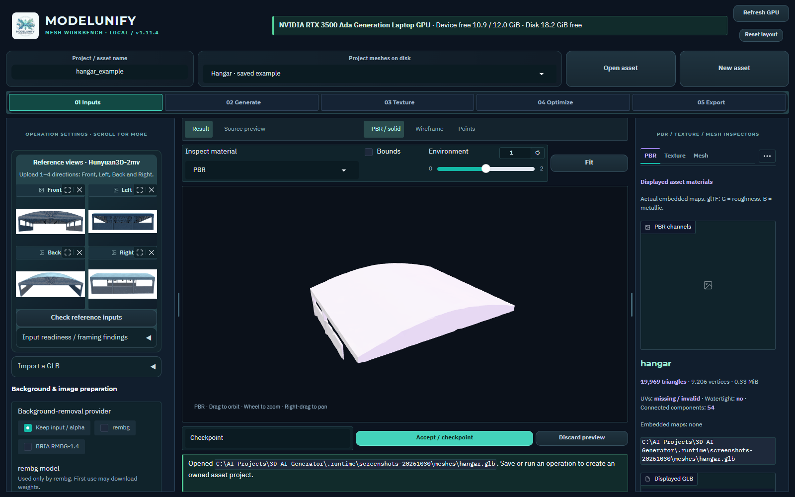
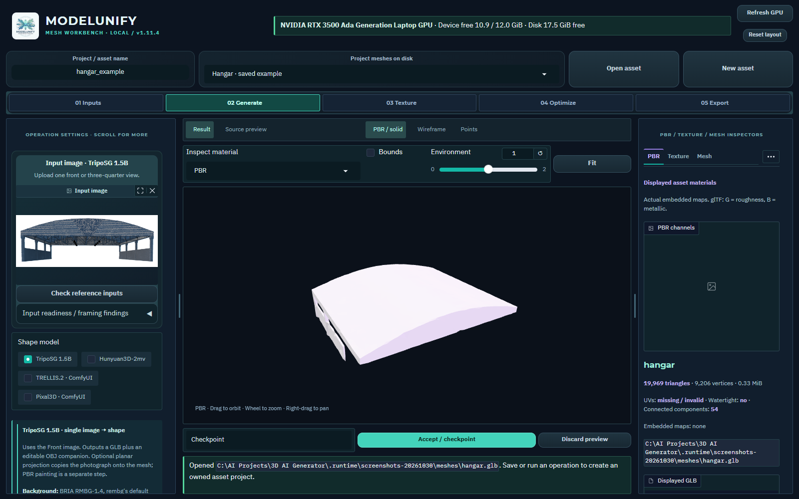
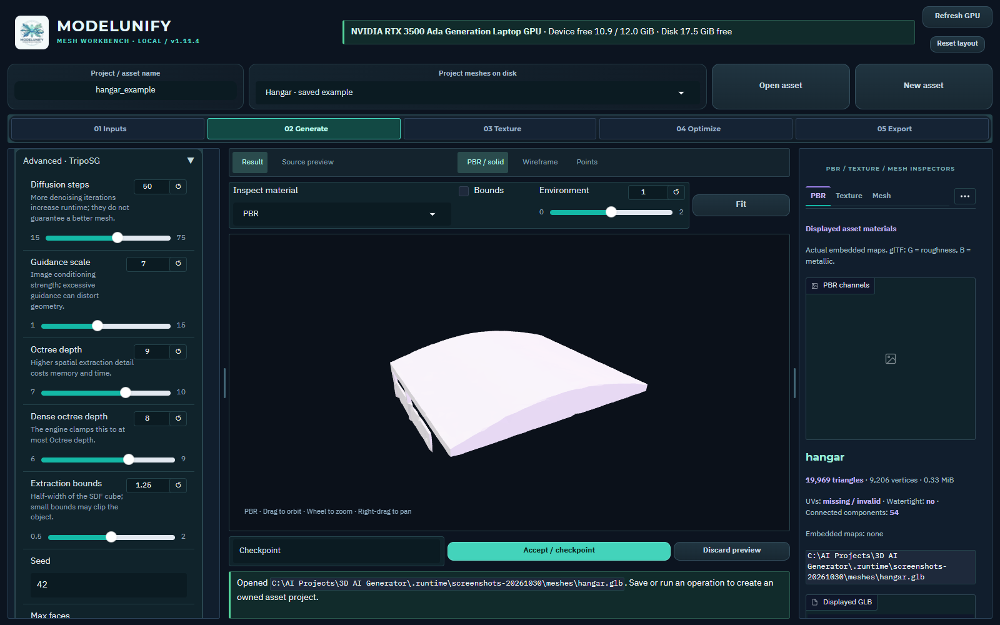
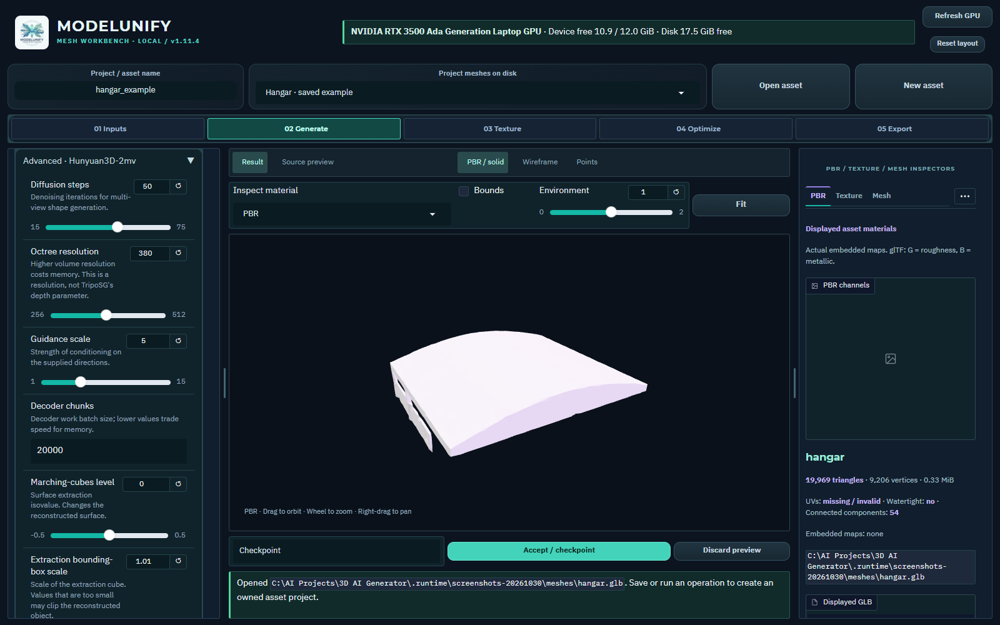
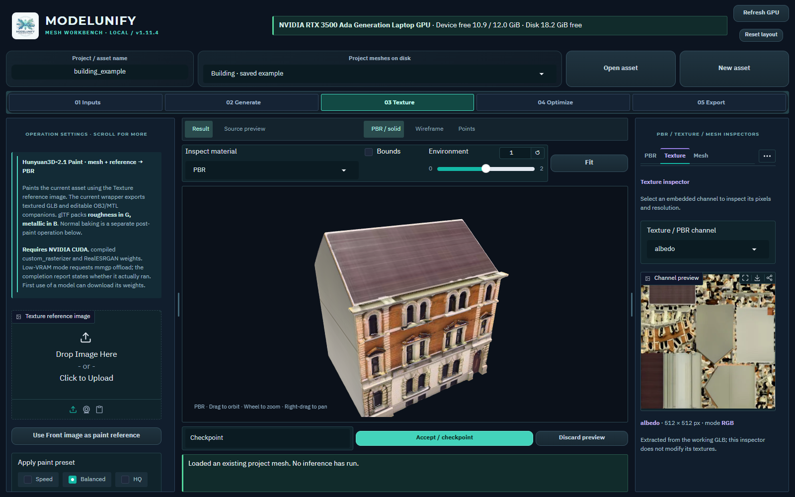
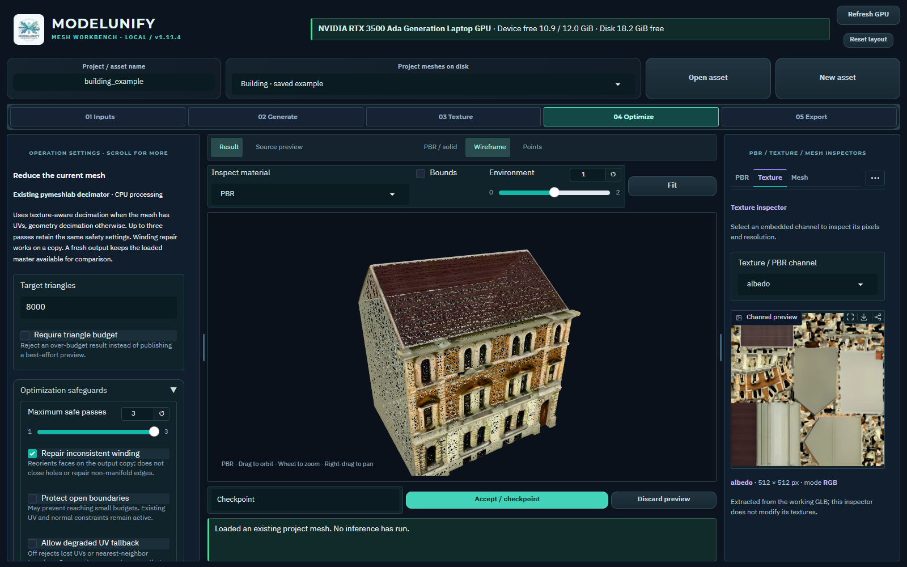
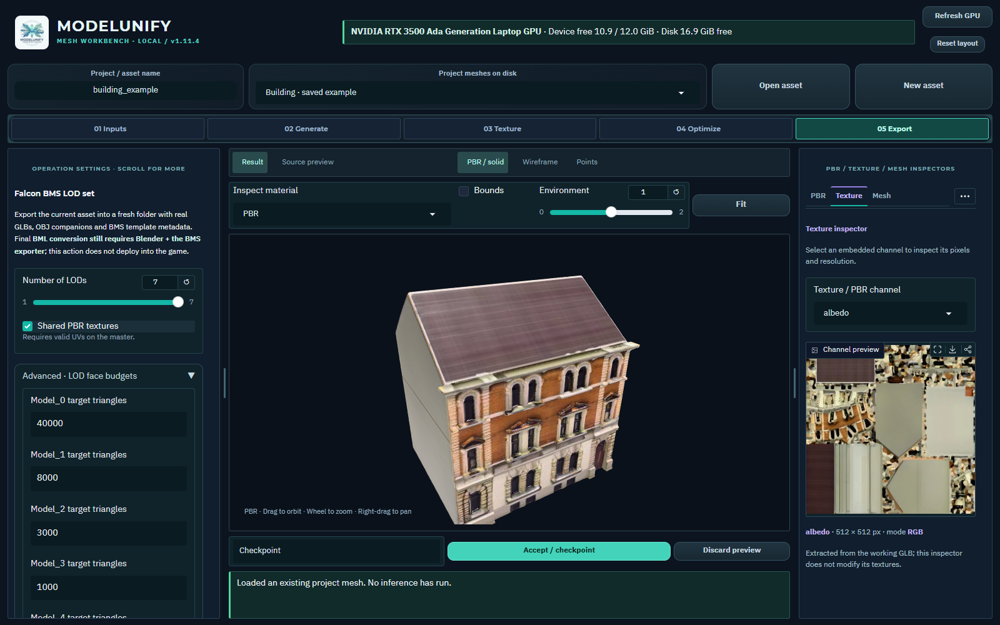
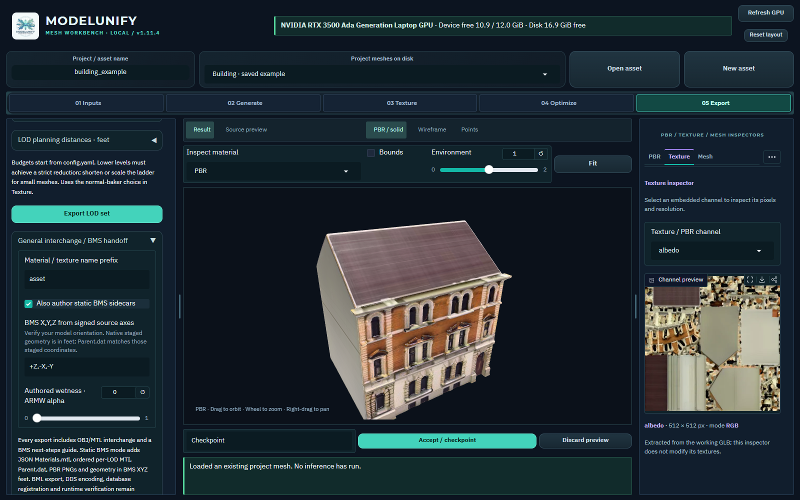

# ModelUnify operating guide

Version 1.12.1 · 30 October 2026

## Executive summary

Use ModelUnify as a saved asset workbench: prepare references, generate geometry, inspect, texture, optimize and export. Accept a named checkpoint after each satisfactory result. For tanks, aircraft and buildings, judge silhouette, openings, symmetry and measured dimensions before surface appearance.

Version 1.12.1 keeps AI weights optional and manages their installation in Models. Once the main environment is installed, existing meshes support inspection, manual masks, CPU optimization, UV rebaking and export. Generation, paint and learned preparation need verified checkpoints and runtimes.

## Available workflows

Generate from photographs, or import a static mesh and continue with inspection and export. AI output is a candidate, not a measured reconstruction.

The Edge/Chrome application window has one persistent 3D viewport and independently scrollable, resizable settings and inspectors.

Windows/NVIDIA CUDA is the validated AI target. CPU mesh tools work independently. AMD ROCm and Intel XPU inference are not integrated; CPU diffusion is very slow.

## First launch

Double-click run_modelunify.bat. Wait for the startup progress and ready URL; cold imports can take a few minutes. Edge, or Chrome as fallback, opens a dedicated Chromium application window. Choose a project name. Open an existing mesh or create a New asset. GLB keeps materials and images together.

Read .runtime/workbench_preview/server.log if startup fails. Ports begin at 7861 with automatic alternatives. run_modelunify.bat --server runs a visible server; stop that session with Ctrl+C. Closing only the application window leaves the server and queued jobs running.

Fresh clones need CPython 3.11 x64 and the environment setup in docs/INSTALLATION.md. Restore selected model weights separately. On a new machine, build native paint extensions with compatible MSVC/CUDA tools; Git excludes machine-specific binaries.

## Key findings

Open **Models** in the asset toolbar to install and manage AI components in the
same window. The **Manage required models** button follows the selected workflow.
The [model manager guide](MODEL_WEIGHTS.md#use-the-models-workspace) covers live
progress, cancellation/resume, repair, runtime checks, storage and reviewed removal.
The Word edition includes the Models manager. Workflow screenshots below retain
their v1.11.4 labels; the Models workspace screenshot shows v1.12.0.

The interface exposes model-specific inputs and settings. Keep the five stages in their working order, but skip generation and paint when an imported mesh already contains the required geometry and materials. No model-quality score or preset proves production accuracy.

## Workbench layout

Left settings panel: Inputs, Generate, Texture, Optimize and Export contain the operation controls. Scroll inside this panel for advanced options. Drag either divider to change panel widths while preserving room for the viewer. Double-click a divider to reset it; Reset layout restores both defaults. Divider keyboard arrows also work.

Center viewer: orbit, pan, zoom and Fit inspect one selected mesh. Switch the working Result, raw master, source, accepted version or LOD in this same viewport. Switching the displayed comparison does not automatically change the mesh on which the next operation runs. Check the working result before submitting a job.

Right inspectors: PBR isolates channels actually present; Texture shows extracted image pixels and dimensions; Mesh shows topology and bounds; Project manages settings, versions and saves; UV shows charts and bounded diagnostics; Jobs exposes queue state, logs and artifacts; Reference compares an aligned silhouette.

A displayed channel is an inspection material, not a newly generated texture map. Missing maps can be intentional constant material factors. Inspect both the Texture pixels and the shaded result. A high polygon count, large atlas or attractive lighting does not establish geometric accuracy.

## Screen tour

The following captures are from the running **v1.11.4** Mesh Workbench at
1600 × 1000. Click an image to open it at full size. Settings and inspectors
scroll independently; controls farther down a panel remain available. Examples
are existing saved outputs opened for inspection, with no new inference or
model downloads during this capture.

### Main screen

Name or open an asset at the top, choose a workflow stage, then use the left
settings panel. The central viewport remains available throughout. The Texture
inspector on the right shows the embedded albedo pixels and their actual size.
Use the inspector's **…** menu for tabs that do not fit across the panel.

### Inputs: Hunyuan multiview

Hunyuan3D-2mv exposes four named directions and accepts any nonempty subset.
These are the saved hangar's actual input images and earlier shape result.
Use **Check reference inputs**, then scroll to background removal, cropping and
mask correction. A matching set of views still does not guarantee that openings
or thin structures will reconstruct correctly.

### Generate: model-specific controls

Selecting TripoSG changes the upload area to a single input. Left, Back and
Right are hidden and are not fused. **Changing the selected model does not
regenerate the preview**: the saved Hunyuan hangar remains displayed here.
Queue Generate mesh to produce a new result with the selected backend.

Scroll within the left panel to adjust diffusion steps, guidance, octree depths,
extraction bounds, seed and face target. Use the model information above these
controls to check capabilities and runtime configuration.

Hunyuan uses extraction **resolution**, decoder chunks and a marching-cubes
level. Its resolution is a different parameter from TripoSG's octree depth.
Use a fixed seed and compare the actual output before raising the settings.

Pixal3D's multiview checkbox selects separate weights for matched fixed-orbit
views. Resolution, working-mesh cleanup and PBR atlas controls are independent.
These are configuration menus; selecting them does not install checkpoints or
run the Comfy host. See [ComfyUI setup](COMFYUI.md).

### Texture and PBR inspection

Texture configures painting of the working mesh. The right Texture inspector
reads maps already embedded in the displayed GLB; inspecting them does not
paint again. The building example contains a 512 × 512 albedo map. Use Inspect
material above the viewport to isolate available channels or show a UV checker.

### Optimize

Set a triangle target, expand **Optimization safeguards** and inspect wireframe
before submitting. The shown 8,000-triangle value is a requested target; the
viewport still shows the existing 40,000-triangle building. Read the completed
report and compare thin parts before accepting an optimized result.

### Export

Choose the number of LODs and decreasing budgets, then review planning distances
and measured scale farther down the panel. The visible values are export
settings, not achieved counts. Inspect each resulting LOD after export.

Expand **General interchange / BMS handoff** to author optional static sidecars.
Verify signed axes and physical scale before export. BML conversion, DDS
encoding, slot reconciliation and in-game checks remain external; see the
[BMS workflow](BMS_WORKFLOW.md). The screenshot shows configuration only.

For building, tank, hangar and aircraft viewport examples, see the
[README gallery](../README.md#example-assets).

## Model selection

TripoSG 1.5B accepts one Front image. Hidden Left, Back and Right images are not fused by this model. Start with Balanced, a fixed seed and a moderate face target. Diffusion steps change denoising effort; octree depth and dense depth control extraction detail and memory. Dense depth is capped by octree depth. Small extraction bounds can clip the object.

Hunyuan3D-2mv accepts any nonempty subset of Front, Left, Back and Right. Supply views of the same object with consistent framing. More directions can clarify hidden geometry, but mismatched subjects or viewpoints can degrade it. Balanced uses 50 steps and extraction resolution 380. Resolution 256 is a draft and 512 increases extraction work. Decoder chunks affect memory/work allocation, not camera calibration.

TRELLIS.2 uses one image through the isolated ComfyUI host. Choose its own structure, shape, upsample and texture controls. Resolution 512 skips upsampling; 1024 and 1536 run that stage. Enable PBR only when needed. The default checkpoint is an INT8 Comfy-Org repack, with shared vision and VAE models.

Pixal3D single-image uses one view. Automatic horizontal FOV needs MoGe; manual FOV uses the supplied value. Pixal3D multiview selects a different checkpoint and allows 1 to 4 fixed-orbit directions. Those views must share framing, scale and horizontal FOV, with 90 degree spacing. Arbitrary satellite and ground photographs are not calibrated automatically.

Hunyuan3D-2.1 Paint takes a mesh plus a reference image. Its baking views are virtual cameras, not additional user photographs. Enable low-VRAM offload on the 12 GB reference GPU. Remeshing can change thin parts and openings. The upstream exporter halves the bake-atlas dimension: a 2048 atlas setting produces approximately 1024-pixel maps. Inspect reported actual map dimensions and views.

Background options are Keep alpha, RMBG-1.4 and rembg. Keep alpha and manual correction can work without a learned remover. rembg exposes u2net, u2netp, isnet-general-use and silueta; each may need its own download. Select an installed ONNX provider. This workstation has CPU ONNX Runtime; selecting CUDA does not install its GPU provider.

Normal options are Off, Low geometry normals, Medium StableNormal and High Marigold. Low uses CPU geometry and no model download. Install Medium/High checkpoints and StableNormal source explicitly in Models. Image-inferred detail does not prove physically correct surface detail. Read the report for the actual baker or fallback.

Accuracy rule. Preserve the original and raw master. Compare at least the front and side silhouettes before accepting a generated or remeshed candidate, especially around tracks, gun barrels, wings, antennae, windows and roof edges.

## Operating implications

Generation and material stages have different dependencies. Models checks files, dependencies and runtimes before GUI jobs are queued. Generation does not install missing checkpoints. ComfyUI's Check model action additionally verifies the selected running graph. For offline work, complete installation and verification before the session.

For Comfy output, inspect master.glb against asset.glb. Working solid remeshing can close holes or merge thin surfaces; decimation can remove detail. Turn remeshing off and set the working budget to zero when you need the raw result. This does not repair inaccurate generation.

The UI queues frozen requests. Changes made after submitting a job apply to later jobs. Save the project to preserve settings and owned inputs, then inspect the completed preview before Accept / checkpoint. Cancellation waits for safe boundaries; a slow CUDA stage may not stop immediately.

## Recommendations

Use the following sequence as an operating procedure. Each operation creates a reviewable working result; it should not replace your only copy of a source asset.

Prepare references. In Inputs, select the remover and its model, preserve meaningful alpha, set crop and modest padding, and run Check reference inputs. Inspect the alpha overlay for missing foreground or retained scenery. Do not generate from an empty or visibly clipped mask.

Correct masks when required. Load the selected direction in Manual mask correction, paint white to restore foreground or black to remove it, and Apply. Undo/Clear affects strokes. Corrections are tied to the exact input pixels; another view does not inherit them. Crop and padding still run once afterward. Manual editing supports images up to 4096 pixels per side.

Generate a baseline. Select the backend and its valid input mode, fix the seed, use Balanced or a low-cost draft, and queue Generate mesh. In Jobs, inspect progress and the operation log rather than repeatedly resubmitting. Compare the result with the raw master and reference directions. Accept a named geometry checkpoint before paint.

Paint and inspect. In Texture, provide a useful reference, choose view and resolution settings and queue paint. Check the actual albedo, metallic, roughness and normal channels. Inspect stretching, seams, unwanted lighting baked into albedo, shiny nonmetal surfaces and missing coverage. Keep geometry and painted checkpoints separate.

Optimize deliberately. Choose a triangle target, UV/material preservation and reasonable bounds/surface guards. One to three bounded passes are available. Strict budget failure should lead to reviewing the target or constraints, not assuming success. Reports show achieved counts and any UV fallback. Bounds and sampled surface checks can still miss a small damaged antenna.

Protect critical parts. Shift-click the working Result to pick a point and create a region from its center and half-size, or enter a coordinate box, triangle IDs or sharp-edge threshold. Preview the green protected faces. Protection applies to this Optimize operation only; recreate it after topology changes. Later paint, remeshing and LOD generation do not inherit it.

Rebake when needed. In UV, select Repair UVs / rebake textures. Reparameterize the current mesh, or supply an aligned higher-detail GLB with valid UVs and textures. Choose 256 to 2048 pixels, padding and projection-distance limits. The CPU tool supports up to 200k target and 1M source triangles; it fails visibly at work limits. Review projection errors and tangent seams before accepting.

Scale and export. Apply measured scale using a known real dimension, up/forward axes and pivot. Export 1 to 7 decreasing LOD budgets with planning distances. Inspect every actual LOD in the single viewer; lower levels must reduce geometry. Download export_package.zip so relative texture and material paths stay together.

## Quality checks

Before acceptance, check silhouette from several directions, physical dimensions, symmetry, components, consistent winding, UV validity and material coverage. Use a neutral environment as well as attractive lighting. Check Reference IoU only after manually aligning yaw, pitch, scale and offset; the orthographic comparison is not a calibrated reconstruction.

For BMS, enable Also author static BMS sidecars only for the supported opaque, single-material, single-skin static asset. Review metres per input unit and the signed-axis mapping. The package contains Wavefront OBJ/MTL, BMS JSON Materials.mtl, per-LOD MTI, Parent.dat and named PNG companions. These two MTL formats have different purposes.

Finish externally: export BMLs in a compatible DCC tool, encode the referenced DDS textures, reconcile MTI with actual BML material-slot order, inspect in BML Workbench/BMS Editor, then validate in a test BMS installation. ARMW means R AO, G roughness, B metallic, A wetness. Albedo uses sRGB; ARMW and normals use linear data. Reserve object IDs and use theater tools for database registration. No handoff alone is certified BMS-ready.

A practical acceptance test is to close and reopen the saved project, verify its inputs and accepted mesh, switch all exported LODs, import the GLB into another viewer, and confirm that textures, dimensions and orientation survive. Keep the run report with the exported asset.

## Appendix

## Restore models

Install only the model weights required for your next operation. Keep environments, original assets and generated outputs separate from checkpoints. Removing a shared cached model can affect other applications that use it.

For an installed Comfy runtime, run .venv/Scripts/python.exe -m scripts.comfyui_host download --model trellis. Alternatives are pixal, pixal-mv and all. For a fresh runtime use setup instead. Check model after installation; keep Comfy separate from the main environment.

Native TripoSG/RMBG use pretrained_weights. Hunyuan, Paint and DINOv2 use the Hugging Face cache; Paint also needs RealESRGAN_x4plus.pth. docs/MODEL_WEIGHTS.md gives exact commands, paths, sizes and checks. Selecting a model does not install its weights.

Existing-mesh inspection, manual alpha editing, CPU optimization, rebaking existing maps and export need no AI checkpoints. Learned workflows remain unavailable until restoration.

## Troubleshooting and sources

Missing checkpoint: restore the selected model, then check readiness. CUDA memory failure: review offload and draft settings; do not replace the CUDA stack silently.

Bad mask: change the provider or correct alpha manually. Lost thin parts: compare raw geometry, disable remeshing, protect the region or raise the budget. Texture gaps: inspect UVs and reference coverage.

Rejected export: read the report and inspect static hierarchy, materials, UVs and budgets. BMS mismatch: verify axes, feet, BML bounds, MTI slots and DDS names externally.

Sources: docs/INSTALLATION.md, MODEL_WEIGHTS.md, COMFYUI.md and BMS_WORKFLOW.md. Controls: scripts/workbench/schema.py and comfyui_workflows.py. Repository: github.com/AsafBSh/ModelUnity.

Version control. Use a feature branch and pull request to main. Keep weights, environments, generated meshes and private references out of Git. No automated status check is required; verify relevant behavior locally. See docs/CONTRIBUTING.md.
